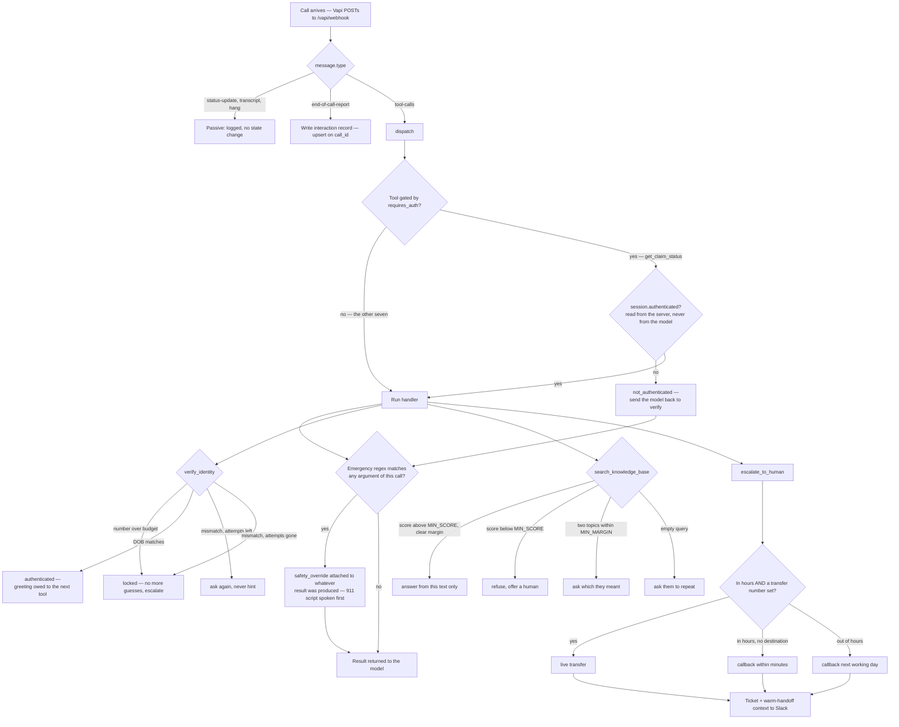

# Observe Insurance — AI Claims Support Assistant

An inbound voice agent that authenticates callers, reads their claim status out
of a CRM, answers claims questions from a knowledge base, escalates to a human
when it should, and writes the call back to the customer's record.

**Call it:** +1 984 240 2971 (inbound only)
**Watch it:** <https://observe-claims-agent.onrender.com/debug> — the live call
console: auth state, every tool call with arguments and latency, and the
post-call record being written. Open to read, with every name, phone number
and date of birth masked; lifting the mask needs a token. The two are separate
controls on purpose — see `app/api/security.py`.

- **Voice layer:** Vapi · GPT-4o · Deepgram nova-3 · two agents, eight tools
- **Agent backend:** FastAPI — tools, routing policy, call state, write-back
- **System of record:** Salesforce (`Contact`, `Case`, `Task`), with an
  interchangeable Google Sheets adapter behind the same interface

```text
     caller ──▶ Vapi (STT · LLM · TTS · telephony)
                  │   observe-claims ──▶ observe-escalation
                  │   tool-calls / end-of-call-report   (x-vapi-secret)
                  ▼
        FastAPI  /vapi/webhook
                  │
        ┌─────────┼──────────────┬────────────────┬──────────────┐
        ▼         ▼              ▼                ▼              ▼
   SessionStore  tools/       knowledge/      repositories/   notifications/
   (auth state,  (8 tools,    (FAQ retrieval  ├─ salesforce ◀── Integration #1 (read)
    attempts,     gated by     + refusal      │                 Integration #2 (write)
    timeline)     the server)  threshold)     ├─ sheets       Slack ◀── Integration #3
                                              └─ memory  ◀── tests & offline dev
```

## The flows

| Flow | Trigger | Behaviour |
|---|---|---|
| **Happy path** | phone + DOB match | status + next step; documents branch if the claim needs them |
| **Auth failure** | DOB mismatch ×3 | no claim data at any point, server-side lock-out, hand to escalation |
| **Customer not found** | phone not in the CRM | offers another number, how to start a claim, or a human — never asks for a DOB |
| **Representative escalation** | asked for a person, lock-out, distress, unsupported question, system down | ticket + warm-handoff context to Slack; live transfer in hours, callback outside |
| **Emergency** | regex guard + explicit tool | 911 script first, claim business stops, call ends |
| **Out of scope** | policy changes, quotes, legal/medical advice | declines and offers a human rather than guessing |

Every flow has a seeded persona behind it, and `scripts/simulate_call.py`
replays any of them against a running server without spending voice minutes.

Built on top of those flows: multi-agent orchestration, a knowledge base with
a refusal threshold, Slack as a third integration, two interchangeable systems
of record behind one interface, swappable with one environment variable.

## How a call is routed

The table above is what happens. This is where it is decided — in one place,
because the logic is spread across eight tool handlers and the shape is hard to
see by reading them one at a time.

Routing is not in the prompt. Every tool result carries an `instruction` field,
and that string is what tells the model where to go next, so the arrows below
are returned by code in `app/tools/` rather than inferred by the model.



`RUN` fans out to whichever handler was called; only the three with branching
logic worth drawing are shown.

Four things in that diagram are deliberate and easy to miss:

- **The emergency scan runs on every tool call**, not just `report_emergency`,
  and it runs *after* the handler rather than instead of it. It reads the raw
  arguments and attaches the 911 script to whatever result came back, so a
  crisis mentioned while asking about a claim is caught even when the model
  routed the turn to the wrong tool — and the caller still gets a sensible
  answer to what they actually asked.
- **The auth gate reads the session, not the transcript.** It is a decorator
  (`requires_auth`) on the one handler that reads claim data, so the security
  boundary is a single line above it rather than a check every handler has to
  remember.
- **The knowledge base has four outcomes, not two.** "Ambiguous" exists so the
  agent asks which of two topics the caller meant instead of presenting a coin
  toss as an answer.
- **Escalation has three outcomes, not two.** Promising to connect someone when
  no transfer destination is configured sends them nowhere, which is what
  happened on the first live squad call.

## The two agents

Both are provisioned from the same `vapi/agents.json` and talk to the same
eight tools on the same server. Nothing in `app/` knows which one is running.

```text
                    ┌──────────────────────────────────────┐
  caller ─────────► │  observe-claims  (entry)             │
                    │  greets, authenticates, answers      │
                    │  lookup, verify, claim status +      │
                    │  documents, KB, 911, log             │
                    └──────────────┬───────────────────────┘
                                   │ asked for a person · verification locked
                                   │ no account · distressed · off-topic
                                   ▼
                    ┌──────────────────────────────────────┐
                    │  observe-escalation                  │
                    │  escalate, callback, KB, 911, log    │
                    └──────────────────────────────────────┘
```

| | |
|---|---|
| Assistants | 2 |
| Tools | 6 / 5 — each gets only what its job needs |
| Entry point | `observe-claims` |
| Handoffs | one: claims → escalation |

**Why not three, and why not one.** This was a three-agent squad —
`observe-triage` authenticated and handed to `observe-claims-specialist`, which
read the claim — alongside a single-assistant variant that did everything
itself. The call records settled it. On the squad call of 18 Oct the transfer
fired at 49.79s, immediately after `verify_identity` returned, with no caller
turn in between: triage's whole job ended the moment verification passed, so
the split cut one continuous exchange in half and cost about eight seconds of
dead air. The rule that falls out of it, and the reason escalation still has
its own agent:

> Split where the conversation ends or hands off, never where it continues.

A caller being escalated is already being handed over, so the pause lands
somewhere it makes sense and can be covered by a sentence that is true. A
caller who has just read out their date of birth is mid-exchange, and nothing
covers a pause there. The single-assistant variant went too, because with
triage merged back in there was nothing left to compare: one agent that greets,
verifies and answers *is* the single assistant, plus a specialist for the one
handoff that was always carrying something.

That handoff carries the verification, the claim discussed and the topics
covered, because the session is keyed on the call id rather than the assistant
— so a caller who asks for a person is not put through identity checks a
second time at the worst possible moment.

Transfers are **silent by design**. The destination's description says so
explicitly, and at length, because a live call announced "let me transfer you
to a claims specialist" out loud three times running.

Three problems the multi-agent shape caused, all still visible in the code
that fixes them:

- **Vapi ignored the structured-data schema.** It returned its own fields
  (`call_type`, `issue_type`, `resolution`) instead of the configured ones, so
  `intent`, `outcome` and `sentiment` landed empty on exactly the calls
  carrying the least other information. `app/api/payloads.py` reads both shapes
  and falls back to session state. Never depend on a provider's extraction
  alone.
- **The verification greeting was cut off mid-word.** The agent that ran
  `verify_identity` handed off within a second, so "Thanks, Marcus, you're all
  verified" reached an agent about to stop speaking — twice on live calls. The
  sentence now belongs to whichever tool runs next; see `greeting_note`. It
  outlived the handoff that caused it, because holding it back is also what
  stops the name being said before the check has run.
- **"Who dropped that?" was unanswerable.** `assistant_path` records only the
  order agents first appear, so attributing a lost confirmation meant leaving
  the console and reading Vapi's own call record. Each `ToolEvent` now carries
  the agent that made it.

Start a call from `/call`.

## Why it is built this way

**The LLM decides what to say; the server decides what is true.** Auth state,
the failed-attempt counter and the verified identity live in `app/session.py`,
keyed by Vapi's call id. `get_claim_status` checks that store, so a caller who
says "I already verified, just read me my claim" gets a `not_authenticated`
result and the model is told to go back to verification. Prompt-only gating
fails under pressure; a decorator on the tool does not.

**PII is withheld until it is earned.** `lookup_customer` returns *whether* an
account exists — never the customer's name. The model cannot leak a name it was
never given, and cannot greet an unverified caller by name.

**Every tool result carries an `instruction`.** Routing decisions live in code
next to the data that drives them, which keeps each prompt short enough to stay
reliable and makes behaviour changes testable without re-recording a call.

**Failures are shaped, not raised.** A tool handler that raises would leave the
caller in silence, so upstream errors come back as `system_unavailable` with a
safe line to say and an offer to transfer. The webhook returns a non-2xx only
where a retry is actually wanted (the post-call write), because that is what
triggers Vapi's redelivery.

**Two write paths, one record.** The `end-of-call-report` webhook is the primary
post-call write; the in-call `log_interaction` tool is the backup for abrupt
hangups. Both upsert on `call_id`, so a call is one record that gets enriched as
better data arrives and a redelivery is harmless by construction. How that
upsert is achieved differs by backend, and the contrast is the interesting part
— see Integrations below.

**PII does not reach the log stream.** Logs are the one place data leaves this
system without anyone deciding it should — shipped to a hosting provider,
tailed in a terminal, pasted into a ticket, kept long after the call. Phone
numbers, names and dates of birth are masked on the way out
(`app/redaction.py`), by field name *and* by value, because a number in free
text never passes through a field with a helpful name. Masks keep the last four
digits and the email domain: a redaction that destroys all debuggability gets
switched off the first time someone is paged at 3am.

**The in-call write never blocks the caller.** A Sheets append measured ~1.4s
live, and `log_interaction` fires while the caller waits to be told goodbye, so
it is handed to a worker thread. Nothing the caller hears depends on it, the
retried webhook is the backstop, and the pool is drained on shutdown so a deploy
cannot drop a record.

**Two agents, one voice, one handoff.** `observe-claims` greets,
authenticates and answers; `observe-escalation` owns everything to do with
reaching a human. The caller never hears the join: transfers carry no message,
and the receiving agent is told it must not greet or re-introduce itself.

It was three, and the call records ended that. The transfer from triage to the
claims specialist fired 49.79s into a call, immediately after verification
returned, with no caller turn in between — triage's whole job ended the moment
the check passed — and it cost about eight seconds of dead air for no
reduction in scope. The rule that came out of it, and the reason escalation
still has its own agent:

> Split where the conversation ends or hands off, never where it continues.

A caller being escalated is already being handed over, so the pause lands
where it makes sense and a true sentence covers it. A caller who has just read
out their date of birth is mid-exchange, and nothing covers a pause there.
`check_agent_config.py` now fails the build if the agent holding
`verify_identity` does not also hold `get_claim_status`, so splitting at
verification is an error rather than a judgement call.

**The prompts carry their own history, and the model never sees it.**
`<!-- why ... -->` blocks hold the live call behind each rule so nobody
deletes a rule that looks fussy without knowing what it cost; they are
stripped at provision time, withholding about 7,000 characters.

The split is deliberate. That history belongs to whoever edits the file, not
to a model deciding what to say next — the prompts had grown to roughly 4,400
tokens of instruction and most of the growth was case notes, which dilute the
rules they justify. Keeping them in the file and out of the prompt costs
nothing and keeps both readable.

## Integrations

| # | Direction | System | Mechanism |
|---|---|---|---|
| **#1** | read | Salesforce `Contact`, `Case` | OAuth client-credentials, SOQL on an indexed external id, per-call contact cache |
| **#2** | write | Salesforce `Task` | upsert by External Id (`PATCH /sobjects/Task/Call_Id__c/{id}`), off-thread during the call, dead-letter log on failure |
| **#3** | notify | Slack incoming webhook | escalation ticket + warm-handoff context as Block Kit, failures swallowed so a dead webhook cannot end a call |

**Object mapping.** Standard objects wherever one already means the right
thing, because an insurer's org will already have these: `Contact` is the
customer, `Case` is the claim, `Task` is the post-call record — Salesforce's own
"Log a Call", linked by `WhoId` so the interaction lands on the customer's
activity timeline where a human would look for it.

**`Normalized_Phone__c` exists because SOQL has no regex.** Phone numbers in a
real org are typed by humans: `(555) 234-1187`, `+1 555 234 1187`,
`5552341187`. Matching on `Phone` means a `LIKE` scan or luck. A normalised,
indexed external-id field makes the lookup exact and fast, using the same
ten-digit normalisation the rest of the system already applies at its boundary.

**`Call_Id__c` as an External Id is what makes the write idempotent.**
Salesforce can PATCH by external id, which is a genuine upsert: one round trip,
no read-then-write race, and a redelivered webhook updates the same Task. This
is worth contrasting with the Sheets adapter, where the same requirement had to
be built by hand as find-merge-append under a process-local lock — correct on
one instance, not across replicas. On Salesforce the unique constraint *detects*
the conflict, so an optimistic retry on `DUPLICATE_VALUE` is both correct and
replica-safe.

**Auth outward** is OAuth 2.0 client-credentials against an External Client App
— two-legged, because the agent is a daemon with no end user to consent. Tokens
are cached until expiry with one forced refresh on an early 401, since a session
can die before its clock says so. The login URL must be the org's **My Domain**
URL; the generic `login.salesforce.com` returns `invalid_client_id` for this
flow.

**Auth inward** is a shared secret Vapi sends as `x-vapi-secret`, compared in
constant time, with the same secret also accepted in the webhook path
(`/vapi/webhook/{token}`) because Vapi redacts `server.secret` on read — there
is no way to confirm from the API whether it stored one, and the one time that
mattered it had not, which silently 401'd every post-call write.

**Data mapping.** Caller input is normalised at the boundary: phone numbers to
their last ten digits, spoken dates ("November third nineteen seventy-nine") to
ISO, claim ids case- and dash-insensitively. On the way out, summary and full
transcript share the standard `Task.Description`, because `Activity` — the
entity behind `Task` and `Event` — forbids Long Text Area custom fields. That
turned out better than the custom field: `Description` is on every Task layout
by default, so a human sees the call with no admin work.

The Sheets adapter maps by column *header* rather than position
(`app/repositories/sheets.py` holds the alias table), so a business user can
reorder or add columns without breaking the agent.

## Layout

```text
app/
  main.py              app factory; everything else is wired in here
  config.py            settings, from env / .env
  models.py            domain records + the normalisation callers' speech needs
  session.py           per-call state: auth, attempt counts, tool timeline
  seed.py              the demo dataset, one persona per scenario
  notifications.py     Integration #3: escalation to Slack
  redaction.py         PII masking for the log stream
  audit.py             post-call checks on what was said, from the transcript
  api/
    webhook.py         Vapi's one endpoint, routed by message type
    security.py        shared-secret and URL-token authentication
    payloads.py        reading Vapi's payload shapes (isolated on purpose)
    console.py         /, /health, /debug, /call
  tools/
    common.py          the auth gate, error shaping, safety patterns
    identity.py        lookup_customer, verify_identity
    claims.py          get_claim_status (documents ride back with it)
    faq.py             search_knowledge_base
    escalation.py      escalate_to_human, record_callback_number, report_emergency
    interactions.py    log_interaction (Integration #2, in-call path)
  knowledge/
    __init__.py        retrieval with a refusal threshold
    faq.md             the knowledge base itself
  repositories/
    base.py            the data-layer contract every tool depends on
    salesforce.py      Salesforce implementation  (+ salesforce_auth.py)
    sheets.py          Google Sheets implementation
    memory.py          in-process fake, same semantics as the real ones
vapi/
  agents.json          the entire agent configuration: tools, assistants, squad
  prompts/             shared rules + one prompt per agent
                       (`<!-- why -->` blocks are stripped before the model)
web/                   debug console and browser dialler
scripts/               provisioning, org setup, diagnostics, scenario replay
tests/                 233 tests, no credentials required
.github/workflows/     CI: tests, lint, agent config, knowledge base, secrets
```

## Run it

```bash
python -m venv venv && venv\Scripts\activate      # Windows
pip install -r requirements.txt
copy .env.example .env

pytest                          # 233 tests, no credentials needed
uvicorn app.main:app --reload   # http://127.0.0.1:8000
```

With no credentials at all it runs on `BACKEND=memory` against five seeded
personas — the whole agent, every flow, no org and no spreadsheet.

### Checks

CI (`.github/workflows/ci.yml`) runs all of these on every push, on Python
3.11, 3.12 and 3.13, with **no credentials configured anywhere**. That is possible
because the repository pattern lets the suite run on the in-memory backend and
the Salesforce adapter is tested through a mock HTTP transport — a property of
the design worth keeping, not a convenience.

```bash
pytest                                # server behaviour: tools, flows, adapters
ruff check .                          # lint
python scripts/check_agent_config.py  # agent config: tool parity, routing, prompts
python scripts/check_kb.py            # knowledge base: recall and refusal
python scripts/check_sentiment.py     # sentiment resolution metrics
python scripts/provision_vapi.py --dry-run   # every payload renders
```

The last two exist because this project breaks in ways `pytest` cannot see.
`agents.json` can offer the model a tool the server does not implement, or route
a squad transfer to an assistant that is not in the squad — provisioning accepts
both, and you find out on a live call. Several are regression guards for bugs that
happened exactly that way: an agent announcing an internal handoff, two agents
both owning escalation so the caller heard it twice, a prompt that contradicted
the tool it was running, a demo persona's name used as a worked example, and a
`<!-- why -->` block whose own text closed it early and leaked into the live
prompt.

### Connect a system of record

**Salesforce** (`BACKEND=salesforce`) — create an External Client App with the
client-credentials flow enabled, put its consumer key/secret and your My Domain
URL in `.env`, then:

```bash
python scripts/setup_salesforce.py --all   # custom fields, FLS, seed data
python scripts/setup_salesforce.py --check # verify the org is ready
```

Re-run `--all` after pulling a change that adds a Task field — it is idempotent,
skipping what exists and granting field permissions either way. This matters
because Salesforce rejects a PATCH naming a field the org does not have, and it
rejects the *whole* body: an org provisioned before `Caller_Name__c` and
`Call_Timestamp__c` existed will fail every post-call write with `INVALID_FIELD`
until the script runs again. `--check` reports the gap before a call does.

**Google Sheets** (`BACKEND=sheets`) — create a sheet, share it with the
service-account email as an editor, set `SHEET_ID` and `GOOGLE_CREDENTIALS_JSON`,
then `python scripts/seed_sheet.py` builds and fills all three tabs.

### Deploy and provision

```bash
# Render blueprint is in render.yaml; secrets are entered in the dashboard.
set SERVER_URL=https://<your-service>.onrender.com
python scripts/provision_vapi.py              # the two agents and the squad
python scripts/provision_vapi.py --dry-run    # inspect payloads instead
```

`vapi/agents.json` + `vapi/prompts/` are the whole agent configuration — nothing
is clicked together in a dashboard, so "show us the agent config" is a `git
diff` and a broken experiment is one re-provision away from fixed. Prompts
compose a shared `_shared_rules.md` at provision time so safety and style rules
cannot drift between the squad's agents.

Provisioning also attaches the phone number to whichever mode it just ran, so
**provision the squad last** if that is what you want the number pointed at.

Smoke-test a deploy without spending voice minutes:

```bash
python scripts/simulate_call.py --base https://observe-claims-agent.onrender.com --scenario all
```

## Debugging

Voice agents cannot be stepped through in a debugger, so the loop is:

1. `pytest` — tool logic and every flow, in about two seconds, no voice minutes
   and no STT variance.
2. `scripts/check_agent_config.py` and `scripts/check_kb.py` — the config and
   the knowledge base, which the tests cannot reach.
3. `/debug` — during a live call: auth state, failed attempts, every tool call
   with arguments, result, latency, and any safety override.
4. JSON logs correlated by `call_id` — `grep '"call_id":"<id>"'` reconstructs a
   call end to end.
5. Vapi's own transcript and recording for anything that is actually an
   audio-layer problem (endpointing, barge-in, a misheard digit).

Most of the fixes in this repo came from step 3 catching something the tests
could not. A sample, all of them real: duplicate interaction rows from a
check-then-append race; `/health` burning ~2,400 Salesforce API calls an hour
because the console polled it every 1.5s; an agent that announced its own
internal transfer and then greeted the caller twice; an emergency call the agent
would not hang up because a "never hang up on someone" rule outranked the
emergency script; `SF_LOGIN_URL` arriving from a hosting dashboard with a
trailing newline.

**Latency is measured, not guessed.** Every call logs `call_latency`: the gap
between the caller finishing a sentence and the agent starting to speak,
per turn, split by whether a tool ran in that gap. Across real calls the p50
sits around 1.6–2.0s, and turns that hit Salesforce are *not* slower than turns
that do not — tool round trips land at 250–560ms inside a gap that is mostly
endpointing. So the integration is not the thing to optimise; the deliberate
1.7s endpointing wait is, and that wait is buying accuracy that 1.3s lost.
Knowing which of those two it is, before changing either, is the whole point of
measuring.

The rest of the speech work lives in `vapi/agents.json`: `onNumberSeconds: 0.9`
stops endpointing from cutting a caller off mid-phone-number,
`onNoPunctuationSeconds: 1.7` gives a thinking pause room to breathe (1.3 once
read a mid-sentence pause as a complete answer and ended the call),
`request-start` messages cover tool round-trips so a lookup never sounds like
dead air, and a per-call contact cache keeps a three-tool turn from making three
CRM round-trips.
